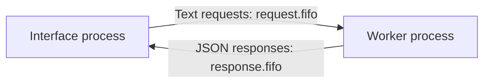
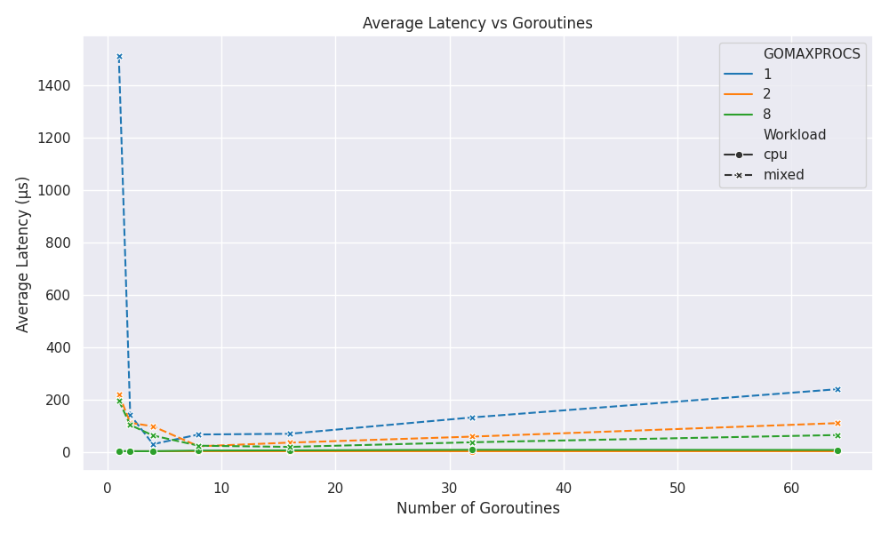

# CA1 · Processes, Concurrency, and Containers

[← All projects](../README.md)

This assignment moves from local message passing to concurrent execution and a network-accessible service. Each part is an independent Go program using the standard library.

## Parts

| Part | Main idea | Guide |
| --- | --- | --- |
| 1 | Arithmetic requests between two processes using named pipes | [IPC worker and interface](part1/README.md) |
| 2 | Scheduling, CPU contention, and synchronization in Go | [Concurrency benchmark](part2/README.md) |
| 3 | HTTP endpoints, Docker packaging, and deployment inside a VM | [HTTP calculator](part3/README.md) |

## Part 1: Named-pipe communication



The worker creates two FIFOs under `CA1/part1/temp/`. The interface sends commands such as `ADD 5 8`, and the worker validates operands and returns a result or an error. Run both processes from `CA1/part1` on Linux or WSL.

## Part 2: Concurrency experiments

The runner evaluates two workloads (`cpu` and `mixed`), seven goroutine counts (`1` through `64`), and three `GOMAXPROCS` settings (`1`, `2`, and the detected CPU count). Each goroutine performs 2,000 tasks. The recorded CSV includes throughput, elapsed time, and task-latency statistics.

Run from `CA1/part2`:

```bash
go run main.go
```

This rewrites `results/experiment_results.csv`. The [plotting notebook](part2/plots.ipynb) generates the included charts from that CSV.



## Part 3: Containerized HTTP service

The calculator listens on port `8080` and exposes `GET /health` and `GET /compute?operator=...&a=...&b=...`.

Run from `CA1/part3`:

```bash
go run main.go
```

Or build and run the container from the same directory:

```bash
docker build -t ds-ca1-calculator .
docker run --rm -p 8080:8080 ds-ca1-calculator
```

Use the [part 3 guide](part3/README.md) for request examples and VM networking.

## Report and evidence

- [Assignment description](DS_CA1_Description.pdf)
- [Submitted report](report.pdf)
- [Original screenshots](images/)
- [Benchmark CSV](part2/results/experiment_results.csv)
- [Plots and notebook instructions](part2/README.md#results-and-plots)
