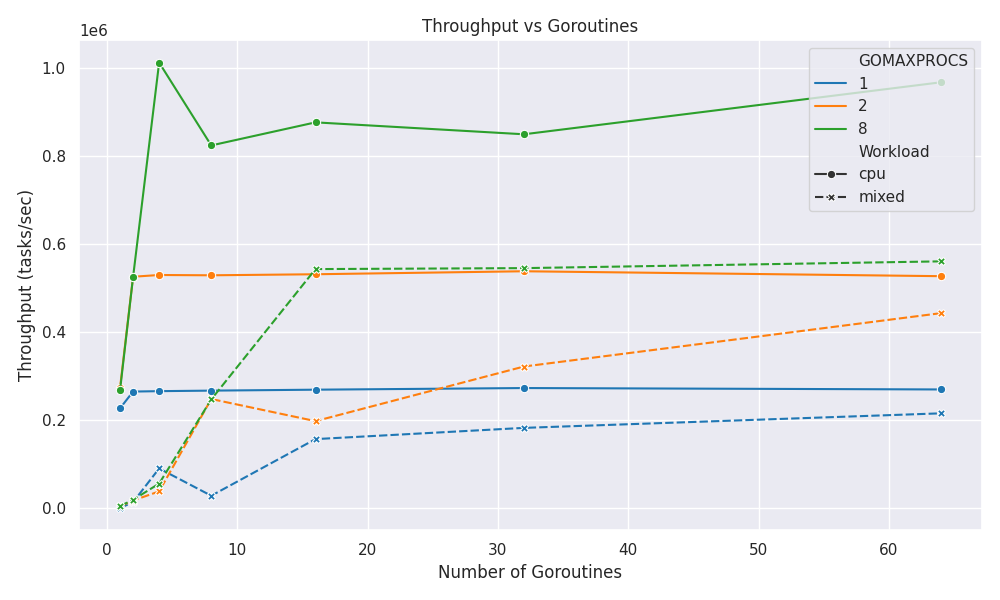

# Part 2 · Concurrency and Scheduling in Go

[← CA1 overview](../README.md)

A benchmark runner measures how goroutine count, `GOMAXPROCS`, and workload type affect throughput and task latency.

## Experiment design

| Parameter | Values |
| --- | --- |
| Goroutines | `1`, `2`, `4`, `8`, `16`, `32`, `64` |
| `GOMAXPROCS` | `1`, `2`, `runtime.NumCPU()` |
| Workload | `cpu`, `mixed` |
| Tasks per goroutine | `2000` |
| Inner-loop iterations | `10000` |

The CPU workload runs a computation loop. The mixed workload combines computation, a shared mutex, and a short sleep. The runner executes 42 parameter combinations; if the detected CPU count is `1` or `2`, some `GOMAXPROCS` settings repeat.

The CSV records workload, scheduler setting, goroutine count, total tasks, throughput, total time, and average/minimum/maximum/standard-deviation task latency. Latencies and elapsed time use microseconds; throughput uses tasks per second.

## Run the benchmark

From **`CA1/part2`**:

```bash
go run main.go
```

Or build and run:

```bash
go build -o part2_experiment main.go
./part2_experiment
```

The runner prints each configuration and **rewrites** `results/experiment_results.csv`. Copy the recorded CSV elsewhere first if you want to compare it with a new run.

## Results and plots

The repository includes the original [CSV](results/experiment_results.csv) and [plotting notebook](plots.ipynb).

| Plot | What it compares |
| --- | --- |
| [Throughput vs. goroutines](results/throughput_vs_goroutines.png) | Task throughput by workload and scheduler setting |
| [Average latency vs. goroutines](results/avg_latency_vs_goroutines.png) | Mean task latency |
| [Latency variation vs. goroutines](results/std_latency_vs_goroutines.png) | Standard deviation of task latency |
| [Throughput vs. latency](results/throughput_vs_latency.png) | Relationship between throughput and average task latency |
| [Latency boxplot](results/latency_boxplot.png) | Distribution of per-configuration average latencies |



To regenerate the plots, install the optional Python dependencies and launch Jupyter from `CA1/part2`:

```bash
python -m pip install jupyter pandas matplotlib seaborn
jupyter notebook plots.ipynb
```

Run the notebook cells in order. They load the relative CSV path and save images in `results/`. Interpret the recorded measurements alongside the [CA1 report](../report.pdf); new results depend on CPU count, operating-system scheduling, and hardware.
