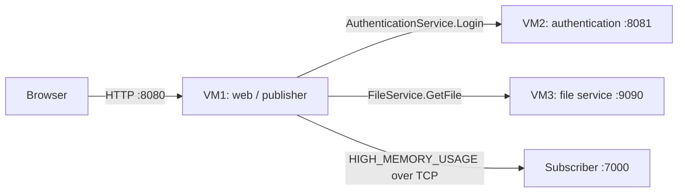

# CA2 · RPC Services and Publish/Subscribe

[← All projects](../README.md)

A distributed web application separates presentation, authentication, and file storage across three VMs. JSON-RPC connects the services; an extended web publisher adds memory monitoring and TCP event notifications.

## Architecture



On a successful login, VM1 asks VM3 for `files/sample.txt` and `images/sample.png`. VM3 returns the contents as base64; VM1 renders the text and embeds the image in the welcome page.

## Components

| Directory | Responsibility | Transport / port |
| --- | --- | --- |
| [web-vm](web-vm/README.md) | Login page, authentication client, and file client | HTTP `8080` |
| [auth-vm](auth-vm/README.md) | Verify credentials against SHA-256 hashes in `users.json` | JSON-RPC over TCP `8081` |
| [file-vm](file-vm/README.md) | Read sample files and return base64 contents | JSON-RPC over TCP `9090` |
| [pubsub](pubsub/README.md) | Extended web publisher and memory-alert subscriber | HTTP `8080`, events over TCP `7000` |
| [rpc-study](rpc-study/rpc-summary.pdf) | Written study of RPC | PDF |

The publisher provides the same login and file-retrieval flow as `web-vm`, plus `/consume-memory` and memory alerts. Choose one web implementation at a time because both listen on `8080`.

## Setup and launch order

Install Go on each VM and ensure the services can reach the ports in the table above. Run every program from its own directory so it can find its templates, user database, or sample files.

### 1. Configure the service addresses

Update `authHost` and `fileHost` in [web-vm/main.go](web-vm/main.go). If using the publisher, update `authHost`, `fileHost`, and `subHost` in [pubsub/publisher.go](pubsub/publisher.go) instead.

The source includes addresses from the original VM setup:

| Constant | Original address | Role |
| --- | --- | --- |
| `authHost` | `192.168.137.131` | VM2 |
| `fileHost` | `192.168.137.132` | VM3 |
| `subHost` | `192.168.137.130` | Subscriber host |

Replace these with your VM addresses. For a local demonstration with separate processes on one machine, use `127.0.0.1` for all three host constants. To reproduce the course deployment, use separate Linux VMs.

### 2. Start the backends

On VM2, from `CA2/auth-vm`:

```bash
go run main.go
```

On VM3, from `CA2/file-vm`:

```bash
go run main.go
```

### 3. Start a web service

For the basic application, run from `CA2/web-vm` on VM1:

```bash
go run main.go
```

For the memory-monitoring version, first run the subscriber from `CA2/pubsub` on the subscriber host:

```bash
go run subscriber.go
```

Then run the publisher from `CA2/pubsub` on VM1, in a separate terminal:

```bash
go run publisher.go
```

### 4. Test the application

Open `http://WEB_VM_IP:8080/`, replacing `WEB_VM_IP` with VM1's address. A local demonstration uses `http://localhost:8080/`.

| Demo username | Demo password |
| --- | --- |
| `alice` | `alice123` |
| `bob` | `bob123` |
| `admin` | `admin123` |

A valid login displays the sample text and image retrieved through RPC. An invalid password displays an error on the login page. These accounts and the SHA-256 scheme are part of the course demonstration.

For the publisher version, allocate memory with:

```bash
curl "http://WEB_VM_IP:8080/consume-memory?mb=100"
```

Repeat as needed to exceed the default **300 MiB** heap threshold. The monitor checks every **3 seconds** and sends one alert after crossing the threshold. Allocated blocks remain referenced until the publisher stops; restart it to release them. See the [pub/sub guide](pubsub/README.md) for configuration and event fields.

## Troubleshooting

| Symptom | Check |
| --- | --- |
| Connection refused during login | VM2 is running; `authHost` and TCP port `8081` are reachable |
| Login succeeds but content cannot be loaded | VM3 is running; `fileHost`, port `9090`, and the sample paths are correct |
| Templates or users cannot be found | Start the program from its component directory |
| Web port already in use | Stop the other web implementation or CA1's calculator |
| No memory alert | The publisher is running, heap usage exceeds the threshold, and the subscriber is reachable on `7000` |

## Report and evidence

- [Assignment description](DS_CA2_Description.pdf)
- [Submitted report](report.pdf)
- [RPC study](rpc-study/rpc-summary.pdf)
- [Original VM screenshots](screenshots/)
