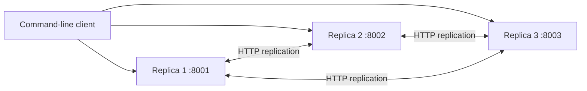

# CA3 · Replication and Consistency

[← All projects](../README.md)

A replicated key-value store with three independent Go HTTP servers, JSON persistence, and a command-line client. The experiments compare asynchronous replication with majority-acknowledged writes under delay, failure, and conflicting updates.

## Architecture



Each replica maintains its own in-memory map and local JSON file. A client can send a request to any replica. The selected server coordinates replication and, in `strong` read mode, queries its peers.

| Directory | Contents |
| --- | --- |
| [replica](replica/README.md) | HTTP server, persistence, replication, and conflict resolution |
| [client](client/README.md) | CLI for `put`, `get`, and `dump` |
| [configs](configs/) | IDs, ports, peer URLs, replication delay, and data-file paths |
| [results](results/) | Recorded observations for four experiment scenarios |

## Quick start

Use Go 1.18 or later. **Run every command in this guide from `CA3`**, rather than the repository root or `replica/`:

```bash
cd CA3
```

Open three terminals in this directory and start one replica in each:

```bash
# Terminal 1
go run replica/main.go -config configs/replica1.json
```

```bash
# Terminal 2
go run replica/main.go -config configs/replica2.json
```

```bash
# Terminal 3
go run replica/main.go -config configs/replica3.json
```

In a fourth terminal, also in `CA3`, write a value:

```bash
go run client/main.go -op put -replica http://localhost:8001 -key x -value 10 -mode eventual
```

Read from another replica:

```bash
go run client/main.go -op get -replica http://localhost:8002 -key x -mode eventual
```

The checked-in configurations delay replication by **2,000 ms**. A sufficiently early read can return `404` or an older value; repeat after a few seconds to observe convergence. Compilation and terminal-switching time can hide this interval. For a repeatable timing experiment, [build the client first](client/README.md#build-once-for-timing-experiments).

Try majority-acknowledged writes and coordinated reads:

```bash
go run client/main.go -op put -replica http://localhost:8001 -key y -value 20 -mode strong
go run client/main.go -op get -replica http://localhost:8002 -key y -mode strong
go run client/main.go -op dump -replica http://localhost:8003
```

The client prints the HTTP status, measured round-trip latency, and JSON body. Stop each server with `Ctrl+C`.

## Consistency modes

The mode names follow the assignment and the source code.

| Behavior | `eventual` | `strong` |
| --- | --- | --- |
| Write | Save locally, respond, and replicate asynchronously | Contact both peers; save locally and report success if at least one peer acknowledges, giving two of three replicas |
| Read | Return the selected replica's local record | Query both peers, choose the newest available record, and repair the selected replica |
| Write with one replica down | Accepted by a running replica | Can succeed with the two remaining replicas |
| Write with only one replica running | Accepted locally | Returns `503` because a majority is unavailable |
| Effect of delay | Extends the period of stale or missing reads | Increases write latency |

**Implementation scope:** `strong` is the assignment's simplified consistency model. There is no consensus protocol or global ordering of concurrent writes, and coordinated reads do not enforce a read quorum. Replication waits for all peer attempts before counting acknowledgements. Failed asynchronous sends are logged without retries or background catch-up; a restarted replica can miss updates until a new write or a coordinated read repairs that key. These details matter when interpreting the experiments.

## Versioning and conflict resolution

A write proposes the receiving replica's current version plus one. Records contain:

```json
{
  "key": "x",
  "value": "10",
  "version": 1,
  "updated_by": "replica1",
  "updated_at": 1781946204655547000
}
```

Incoming updates are compared in this order:

1. Higher `version` wins.
2. For equal versions, the lexicographically larger `updated_by` replica ID wins.
3. For equal versions and IDs, the larger `updated_at` timestamp wins when selecting a record.

With the supplied IDs, the priority is `replica3 > replica2 > replica1`. Matching key, value, version, and author fields are treated as duplicate records by the replication handler. This is a deterministic version-and-replica-ID policy; timestamps are only a final tie-breaker.

## Experiments and recorded results

| Scenario | What to observe | Recorded evidence |
| --- | --- | --- |
| 1: Temporary inconsistency | Write to replica 1, read immediately from replica 2, then read after propagation | [scenario1.txt](results/scenario1.txt) |
| 2: Replica failure | Stop replica 3; compare both write modes. Stop replica 2 as well and retry a `strong` write | [scenario2.txt](results/scenario2.txt) |
| 3: Concurrent conflict | Write different values for one key to two replicas before replication completes; inspect the winner | [scenario3.txt](results/scenario3.txt) |
| 4: Network delay | Compare `0`, `500`, and `2000` ms replication delays | [scenario4.txt](results/scenario4.txt) |

Selected client measurements from the recorded delay experiment:

| Replication delay | Eventual PUT latency | Strong PUT latency | Immediate read from replica 2 |
| --- | --- | --- | --- |
| 0 ms | 24.230 ms | 33.476 ms | New value observed |
| 500 ms | 26.723 ms | 542.737 ms | New value observed in this run |
| 2000 ms | 23.782 ms | 2041.933 ms | Key not found before propagation |

These are original observations from [scenario 4](results/scenario4.txt), not a new benchmark. An "immediate" read may happen after propagation because of client startup and command timing. Scenarios 1 and 2 used a 4,000 ms delay; the checked-in configurations use 2,000 ms.

To reproduce a scenario, edit `replication_delay_ms` in all three configuration files, restart the replicas, and follow the commands in its observation file. Use a fresh key or reset persisted data between runs.

## Configuration and persistence

| Replica | Port | Default data file |
| --- | --- | --- |
| `replica1` | `8001` | `results/replica1_data.json` |
| `replica2` | `8002` | `results/replica2_data.json` |
| `replica3` | `8003` | `results/replica3_data.json` |

The `peers` URLs use localhost for separate processes on one machine. For multiple machines, replace them with reachable HTTP addresses. Keep the configured `data_file` parent directory present; `results/` is included in the repository.

Generated replica data is ignored by Git. To start a fresh experiment, **stop all replicas first**, then remove only their persisted data files from `CA3`:

```bash
rm -f results/replica1_data.json results/replica2_data.json results/replica3_data.json
```

On Windows PowerShell:

```powershell
Remove-Item -LiteralPath results/replica1_data.json, results/replica2_data.json, results/replica3_data.json -ErrorAction SilentlyContinue
```

Restart the replicas after clearing their data. This preserves the recorded `scenario*.txt` observations.

## Report and further documentation

- [Assignment description](DS_CA3_Description.pdf)
- [Submitted report](report.pdf)
- [Replica configuration and HTTP API](replica/README.md)
- [Client flags and timing workflow](client/README.md)
