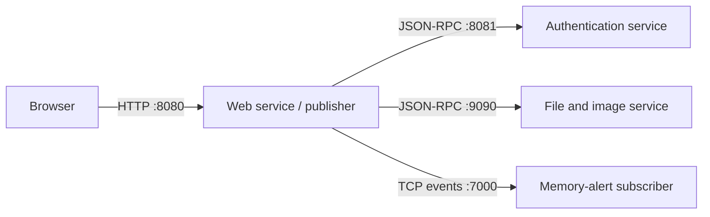

# Distributed Systems Course Projects

**University of Tehran · Distributed Systems**

From communication between two processes to a replicated key-value store: three course projects exploring concurrency, remote services, and consistency through implementations and experiments.


[](https://github.com/Amink8203/Distributed-Systems-Course-Projects/actions/workflows/build.yml)

[Projects](#projects) · [Getting started](#getting-started) · [Reports](#reports-and-assignment-descriptions) · [Repository map](#repository-map)

## Projects

| Project | What it explores | Implementation and evidence |
| --- | --- | --- |
| [CA1: Processes, concurrency, and containers](CA1/README.md) | Inter-process communication, Go scheduling, and service deployment | FIFO calculator, goroutine benchmarks, Dockerized HTTP service, CSV data, and plots |
| [CA2: RPC services and publish/subscribe](CA2/README.md) | Service separation, communication across VMs, and event notifications | Web, authentication, and file services using JSON-RPC; TCP memory alerts |
| [CA3: Replication and consistency](CA3/README.md) | Replication delay, stale reads, replica failure, and conflicting writes | Three HTTP replicas, a command-line client, versioned records, and four recorded scenarios |

### CA1 · Processes, concurrency, and containers

- **[Named-pipe IPC](CA1/part1/README.md):** two independent Go processes exchange arithmetic requests and JSON responses through FIFOs.
- **[Concurrency experiments](CA1/part2/README.md):** compare CPU and mixed workloads across goroutine counts and `GOMAXPROCS` settings.
- **[HTTP calculator](CA1/part3/README.md):** expose health and computation endpoints, package the service with Docker, and access it from a host through a VM.

An example from the recorded benchmark results:


[Explore the data and plotting notebook →](CA1/part2/README.md#results-and-plots)

### CA2 · RPC services and publish/subscribe

A web server delegates login verification and file retrieval to separate services. An extended publisher also monitors its Go heap and sends high-memory events to a subscriber.



[Architecture, VM configuration, and launch order →](CA2/README.md)

### CA3 · Replication and consistency

Three independent replicas store versioned key-value records and exchange updates over HTTP. The client selects either `eventual` mode or the assignment's simplified `strong` mode, which uses majority-acknowledged writes and coordinated reads.

The recorded experiments cover temporary inconsistency, replica failure, concurrent conflicts, and artificial network delay. The documentation explains the implementation's [consistency behavior and limits](CA3/README.md#consistency-modes).

[Start the replicas and reproduce the experiments →](CA3/README.md)

## Getting started

```bash
git clone https://github.com/Amink8203/Distributed-Systems-Course-Projects.git
cd Distributed-Systems-Course-Projects
```

All Go programs use the **standard library**. Run or build each entry point by filename; several directories contain separate programs with their own `main` functions, so `go run .` and `go build ./...` are not the intended commands.

| Requirement | Used for |
| --- | --- |
| Go 1.18 or later | Language features used by the source; automated builds use Go 1.26 |
| Linux, a Linux VM, or WSL | Required for CA1's FIFO worker; the course's VM exercises use Linux |
| Docker | CA1's container deployment |
| Python, Jupyter, pandas, matplotlib, and seaborn | Optional: rerun CA1's plotting notebook |

For a quick single-service demo, open a terminal at the repository root:

```bash
cd CA1/part3
go run main.go
```

In another terminal:

```bash
curl "http://localhost:8080/health"
curl "http://localhost:8080/compute?operator=add&a=10&b=20"
```

The computation returns `{"operation":"add","a":10,"b":20,"result":30}`. Stop the server with `Ctrl+C`.

For a multi-process demo, follow the [CA3 quick start](CA3/README.md#quick-start). For the VM-based system, begin with the [CA2 setup guide](CA2/README.md#setup-and-launch-order).

**Working directories matter:** CA1's FIFOs and benchmark output, CA2's user database and templates, and CA3's data files use relative paths. Each project guide states where to run its commands. CA1's calculator and CA2's web service both use port `8080`; run them separately.

## Reports and assignment descriptions

| Project | Assignment description | Submitted report | Additional evidence |
| --- | --- | --- | --- |
| CA1 | [Description](CA1/DS_CA1_Description.pdf) | [Report](CA1/report.pdf) | [Benchmark results](CA1/part2/results/) · [Screenshots](CA1/images/) |
| CA2 | [Description](CA2/DS_CA2_Description.pdf) | [Report](CA2/report.pdf) | [RPC study](CA2/rpc-study/rpc-summary.pdf) · [Screenshots](CA2/screenshots/) |
| CA3 | [Description](CA3/DS_CA3_Description.pdf) | [Report](CA3/report.pdf) | [Scenario observations](CA3/results/) |

Recorded measurements describe the original experiment runs. Timing and convergence observations can vary with hardware, configuration, and request scheduling.

## Repository map

```text
.
├── CA1/
│   ├── part1/                 # FIFO worker and interface
│   ├── part2/                 # Benchmark runner, notebook, and results
│   ├── part3/                 # HTTP calculator and Dockerfile
│   ├── images/                # Original experiment screenshots
│   ├── DS_CA1_Description.pdf
│   ├── report.pdf
│   └── README.md
├── CA2/
│   ├── auth-vm/               # Authentication JSON-RPC server
│   ├── file-vm/               # File and image JSON-RPC server
│   ├── web-vm/                # Web interface and RPC clients
│   ├── pubsub/                # Extended web publisher and TCP subscriber
│   ├── rpc-study/             # RPC study document
│   ├── screenshots/           # Original VM demonstration screenshots
│   ├── DS_CA2_Description.pdf
│   ├── report.pdf
│   └── README.md
├── CA3/
│   ├── replica/               # HTTP replica server
│   ├── client/                # Command-line HTTP client
│   ├── configs/               # Three replica configurations
│   ├── results/               # Four recorded experiment scenarios
│   ├── DS_CA3_Description.pdf
│   ├── report.pdf
│   └── README.md
└── .github/workflows/build.yml # Builds every Go entry point on Linux
```

## Course context

Maintained by [Amink8203](https://github.com/Amink8203) as a portfolio of Distributed Systems coursework at the University of Tehran. The source code, reports, and recorded results are organized by assignment so each experiment can be studied alongside its implementation.
